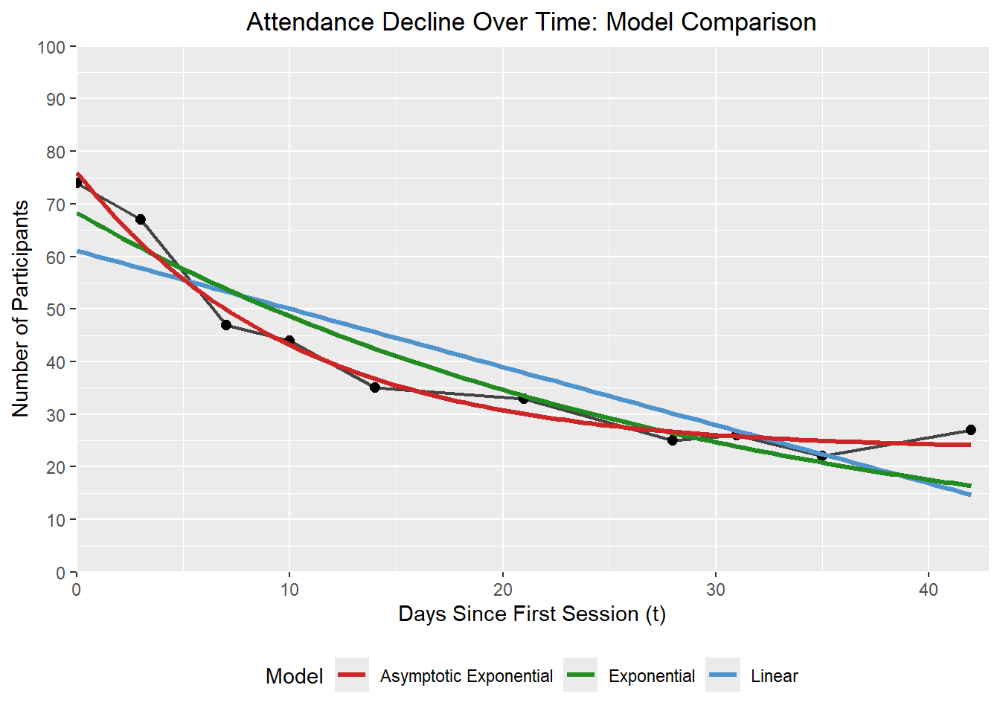
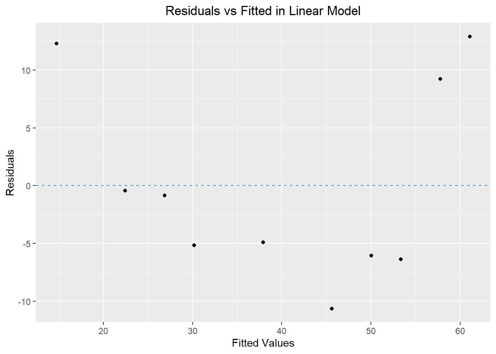
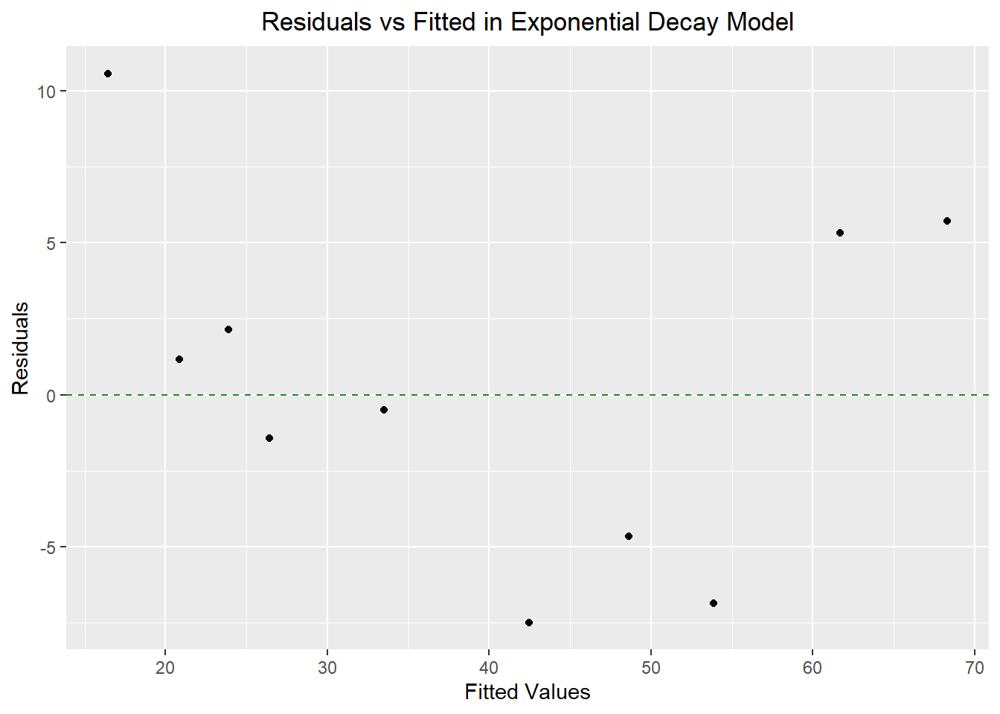
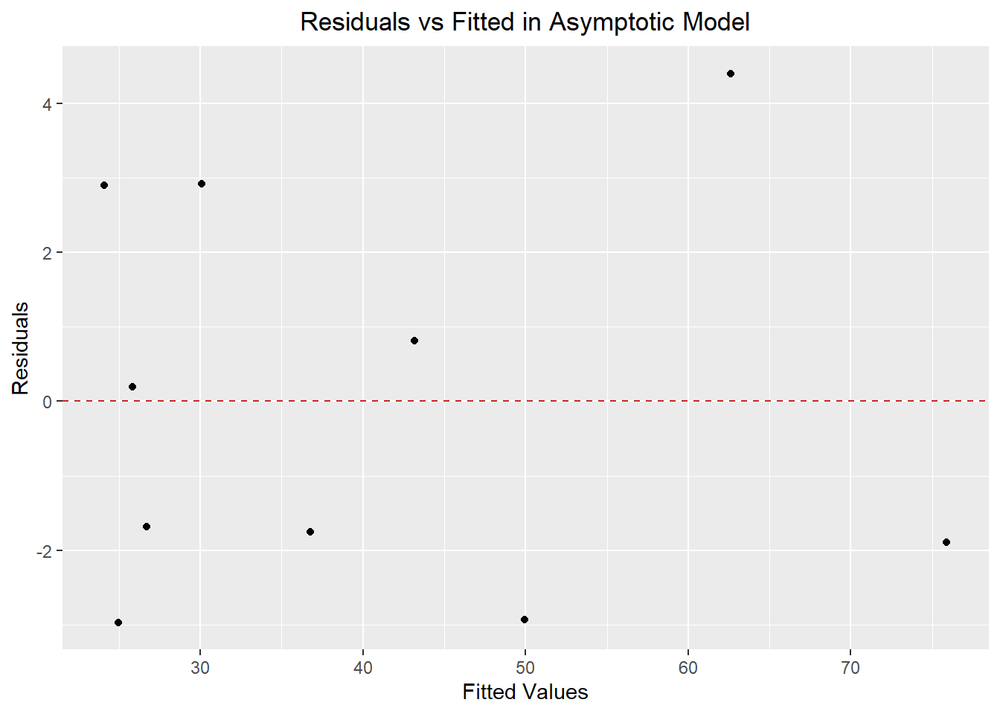
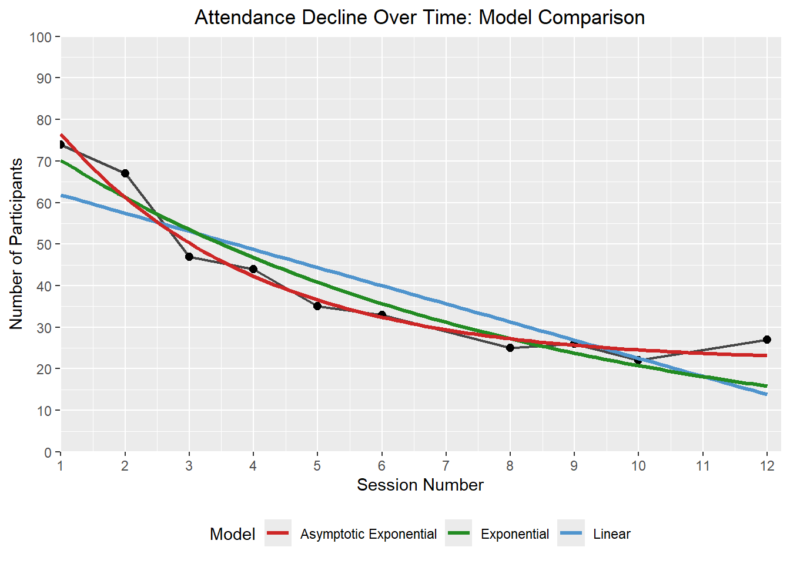
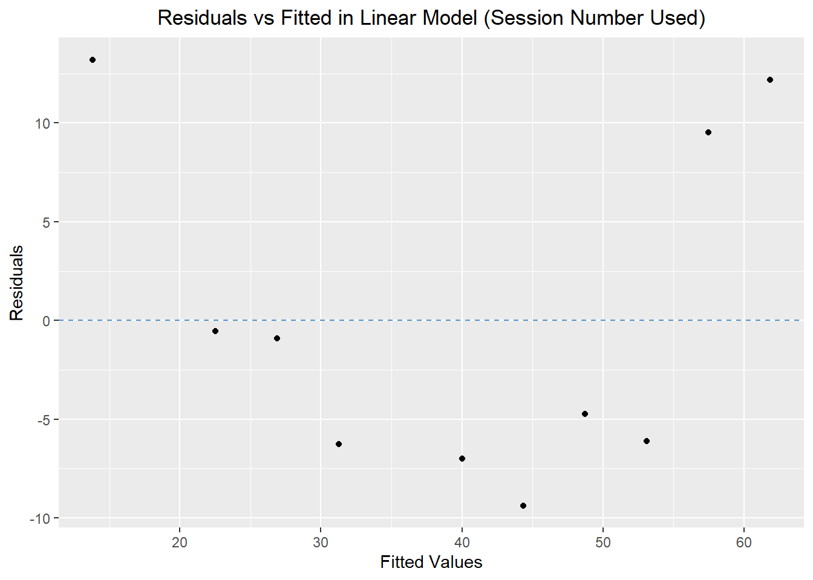
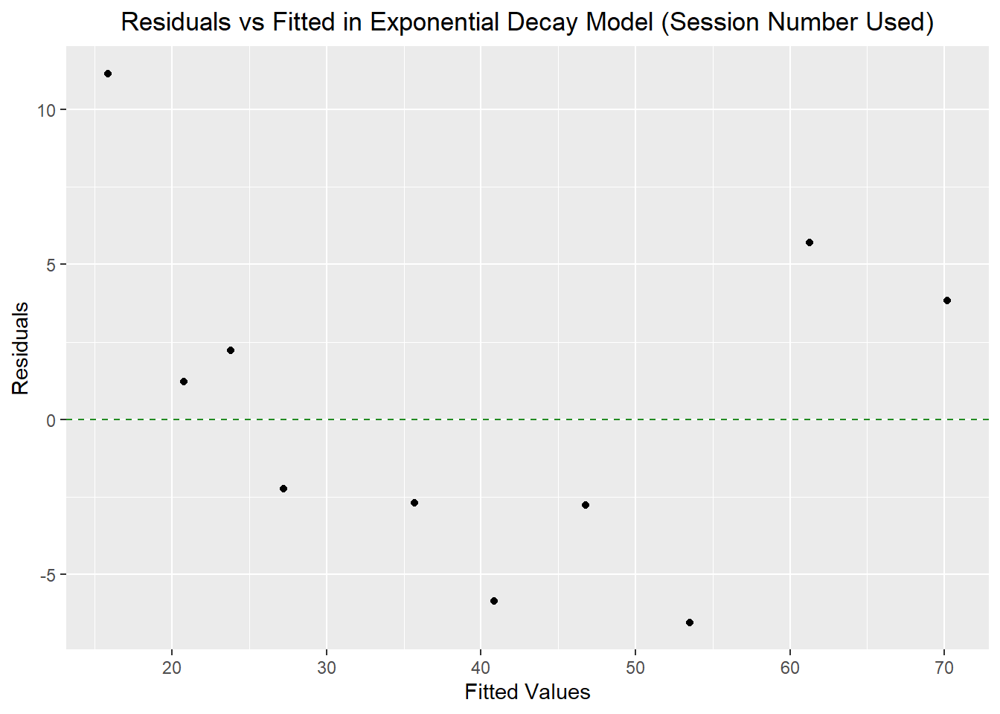
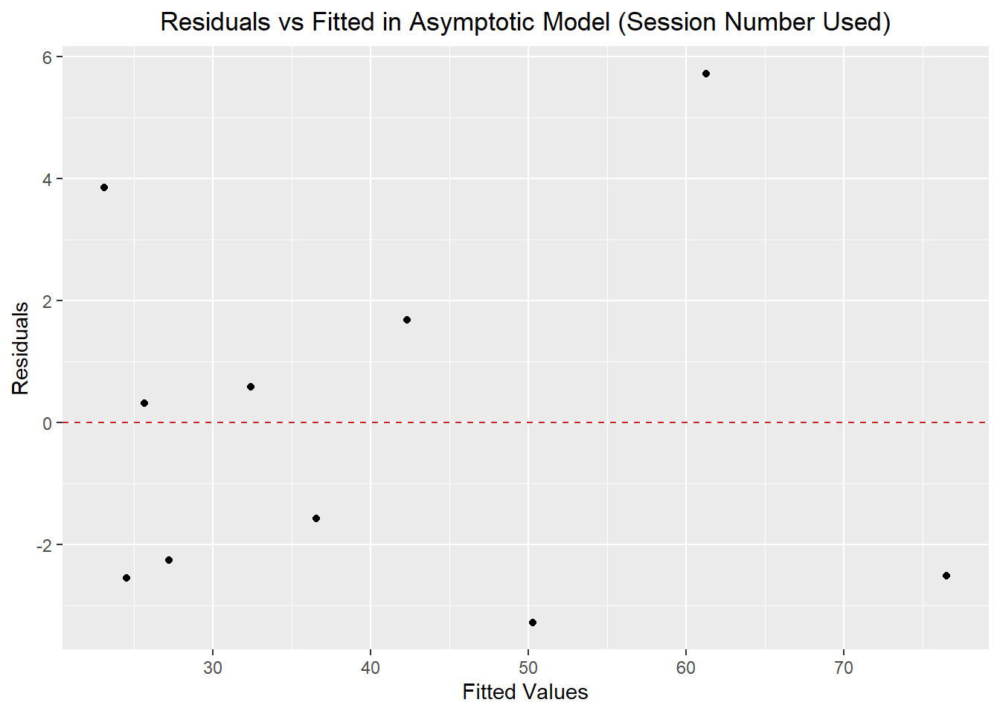

# Statistical Analysis of an Online Course Attendance

[](https://hits.sh/github.com/Shah-Md-Tasrif-Rahman/R_Attendance_CUSPC_SPSS_2026/)

## Overview

This repository contains statistical analyses of the attendance dataset of an SPSS course hosted by [Programming Club, Dept. of Statistics, CU](https://www.linkedin.com/company/programmingclub-stat-cu/), and conducted by [Md Ahsanul Islam (Himel)](https://www.linkedin.com/in/mdahsanulhimel/).

This project examines participant attendance patterns across multiple sessions and compares regression models for describing attendance trajectories in this course and potentially similar courses.

Main tools used for this project are: **R, renv, Jamovi, and Quarto.**

*This repository also contains a pseudonymized version of the original dataset for replication and future uses.*

## Dataset & Data Privacy

### Original Data

The original data for this project was collected using an extension in Google Meet to generate detailed meeting reports in CSV format. The course had a total of 12 sessions, which were held from 14/7/2026 to 25/8/2026. Due to technical errors, attendance records for sessions 7 and 11 were missing, leaving 10 observed sessions out of 12.

Key variables in the original dataset were:
- Participant Name
- Time when attendance started
- Joining time
- Time when attendance stopped
- Attendance duration

### Data Preparation

The CSV files for the 10 sessions were extracted and combined, and then attendance duration was calculated as a new numeric variable. Date-related variables were also included. This produced a master dataset for subsequent processing. A leaderboard, daily attendance summary, weekday summary, and paired weekdays data was created.

### Privacy & Pseudonymization

The original dataset contained participants' real names, which would compromise their privacy if published. To make the dataset publicly available, the names were pseudonymized, and new datasets were created using those pseudonyms. The pseudonymized datasets were then used for furthur statistical analysis.

The repository is designed so the analytical/visualization portion doesn't require the original dataset with PII.

**Check out the [pseudonymized master_dataset](./Pseudonymization_process/Public_datasets/pseudonymized_master_dataset_full_context.xlsx)**

**Check out [all datasets](./Pseudonymization_process/Public_datasets/)**

## Research Questions

1. How is the attendance duration of participants distributed?

2. Is there a difference in participants' mean attendance duration between Tuesdays and Fridays?

3. Which regression model explains the participant attendance pattern best?

## Methods

#### Exploratory Data Analysis

- Descriptive statistics
- Distribution shape characteristics
- Visualization

#### Comparison Between Weekdays

- Normality tests
- Wilcoxon signed-rank test
- Visualization

#### Regression Models

- Linear model
- Exponential decay model
- Asymptotic exponential decay model

#### Model Diagnostics and Comparison

- ANOVA
- Heteroscedasticity Tests
- Durbin-Watson test
- Residual analysis
- AIC
- BIC
- RMSE
- Model visualization

## 1st Research Question

Let's see some descriptive statistics for the attendance duration of participants in this course.

#### Descriptive Statistics

| Statistic | Value |
|:----------|------:|
| *N* | 400 |
| Mean | 71.5 |
| SD | 33.1 |
| SE | 1.66 |
| Median | 82.3 |
| IQR | 45.6 |
| Minimum | 0.167 |
| Maximum | 128 |
| Skewness | -0.722 |
| SE of skewness | 0.122 |
| Kurtosis | -0.543 |
| SE of kurtosis | 0.243 |
| **Shapiro-Wilk *W*** | 0.916 |
| **Shapiro-Wilk *p*** | < .001 |

*Note*. SD = standard deviation, SE = standard error, IQR = interquartile range. All the values are as minutes of attendance.

The Shapiro–Wilk test provides `evidence against normality of the attendance-duration distribution`.

#### Q-Q plot


#### Attendance duration histogram


From these visualizations, we can see that the distribution of attendance duration of participants in this course is `negatively skewed and platykurtic`.

## 2nd Research Question

In this course, sessions were held at either Tuesday or Friday. Since this was an online course, participants were expected to stay longer in sessions at Friday (which counts as a weekend in this context). This course was mostly attended by university-level students. To test whether there's a difference between the average attendance duration of participants at Tuesday or Friday, a **paired-samples measure** was decided to be used.

First, we assess the distribution of the paired differences to decide which test we should use.

#### Normality Tests

| Test | Statistic | *p* |
|:------|:----------:|:--:|
| Shapiro-Wilk | 0.933 | .002 |
| Kolmogorov-Smirnov | 0.131 | .217 |
| Anderson-Darling | 1.29 | .002 |

The paired differences were assessed for normality. Given the observed distribution and the test assumptions, we'll use the **Wilcoxon signed-rank test**.

#### Descriptives

| Group | *N* | Mean | Median | SD | SE |
|:------|--:|-----:|-------:|---:|---:|
| Tuesday_Mean_Minutes | 62 | 68.8 | 71.2 | 23.1 | 2.93 |
| Friday_Mean_Minutes | 62 | 72.7 | 78.8 | 27.2 | 3.45 |

*Note*. SD = standard deviation, SE = standard error.

The Wilcoxon signed-rank test `didn't provide sufficient evidence of a difference between Tuesday and Friday attendance durations`, *W* = 747, *p* = .108.


So there's some difference between the attendance duration, but it's not statistically significant.

## 3rd Research Question

Let's look at how the participant attendance number is distributed first.


The observed trajectory suggests that linear and exponential decay models are reasonable candidate forms to investigate. Let's fit a linear regression model first.

#### Normality Tests

| Test | Statistic | *p* |
|:------|:--:|:--:|
| Shapiro-Wilk | 0.868 | .096 |
| Kolmogorov-Smirnov | 0.221 | .638 |
| Anderson-Darling | 0.622 | .075 |

*Note*. Not enough evidence to reject normality was found here.

#### Heteroscedasticity Tests

| Test | Statistic | *p* |
|:------|:--:|:--:|
| Breusch-Pagan | 0.771 | .380 |
| Goldfeld-Quandt | 0.913 | .529 |
| Harrison-McCabe | 0.685 | .809 |

*Note*. Not enough evidence to reject homoscedasticity was found here.

#### Model Fit Measures

| *R* | *R²* | Adjusted *R²* | AIC | BIC | RMSE | *F* | df1 | df2 | *p* |
|:--:|:--:|:--:|:--:|:--:|:--:|:--:|:--:|:--:|:--:|
| 0.884 | 0.781 | 0.753 | 76.0 | 76.9 | 8.03 | 28.5 | 1 | 8 | < .001 |

*Note*. Model estimated using sample size of n = 10.

#### Model Coefficients

| Predictor | Estimate | SE | *t* | *p* |
|:--:|:--:|:--:|:--:|:--:|
| Intercept | 61.09 | 4.866 | 12.55 | < .001 |
| t | -1.10 | 0.207 | -5.34 | < .001 |

*Note*. Model predicts participants over time (t). SE = standard error.

#### Durbin-Watson Test

| Autocorrelation | DW Statistic | *p* |
|:--:|:--:|:--:|
| 0.372 | 0.762 | .002 |

*Note*. There's statistically significant evidence of positive autocorrelation in the model residuals.

#### Regression Plot


#### Q-Q Plot


#### Residual vs. Fitted Plot


As we can see, the linear model shows evidence of positive residual autocorrelation and potential lack of fit in the diagnostic plots. We'll next examine a log-linear model to assess whether the transformation provides a more appropriate representation of the attendance trend.

#### Normality Tests

| Test | Statistic | *p* |
|:------|:--:|:--:|
| Shapiro-Wilk | 0.874 | .112 |
| Kolmogorov-Smirnov | 0.271 | .383 |
| Anderson-Darling | 0.644 | .065 |

*Note*. Not enough evidence to reject normality was found here.

#### Heteroscedasticity Tests

| Test | Statistic | *p* |
|:------|:--:|:--:|
| Breusch-Pagan | 0.835 | .361 |
| Goldfeld-Quandt | 6.06 | .087 |
| Harrison-McCabe | 0.462 | .419 |

*Note*. Not enough evidence to reject homoscedasticity was found here.

#### Model Fit Measures

| *R* | *R²* | Adjusted *R²* | AIC | BIC | RMSE | *F* | df1 | df2 | *p* |
|:--:|:--:|:--:|:--:|:--:|:--:|:--:|:--:|:--:|:--:|
| 0.923 | 0.852 | 0.833 | -3.14 | -2.23 | 0.153 | 46.0 | 1 | 8 | < .001 |

*Note*. Model estimated using sample size of n = 10.

#### Model Coefficients

| Predictor | Estimate | SE | *t* | *p* |
|:--:|:--:|:--:|:--:|:--:|
| Intercept | 4.1174 | 0.09289 | 44.32 | < .001 |
| *t* | -0.0268 | 0.00395 | -6.78 | < .001 |

*Note*. Model predicts participants over time (t). The variable "Participants" was transformed into ln_Participants for this model. SE = standard error.

#### Durbin-Watson Test

| Autocorrelation | DW Statistic | *p* |
|:--:|:--:|:--:|
| 0.149 | 1.16 | .070 |

*Note*. There's not enough evidence of autocorrelation in the model residuals.

#### Regression Plot


#### Q-Q Plot


#### Residual vs. Fitted Plot


The log-linear model shows less evidence of residual autocorrelation (Durbin–Watson *p* = .070), although the small sample size limits the test's power. The residual plots also indicate that potential lack of fit remains.

We therefore examine **exponential decay and asymptotic exponential decay models** as alternative specifications.

The preceding analyses were conducted in Jamovi. We then use R's nonlinear least squares function, `nls()`, to fit the alternative models.

### Regression Model Fitting

Let's consider the following regression models:

```math
\begin{aligned}
\text{Linear model (Baseline model):}\quad
& y_i = z + tx_i + \varepsilon_i \\

\text{Exponential decay model:} \quad
& y_i = ae^{bx_i} + \varepsilon_i,\; b<0 \\

\text{Asymptotic exponential model:} \quad
& y_i = c + ae^{bx_i} + \varepsilon_i,\; b<0
\end{aligned}
```
Where,
```math
\begin{aligned}
y_i &= \text{Number of participants (Target variable)} \\
x_i &= \text{Days since first session (Explanatory variable)} \\
z &= \text{Intercept of the linear model} \\
t &= \text{Linear rate of change} \\
a &= \text{Amplitude of the exponential component} \\
b &= \text{Exponential decay rate} \\
c &= \text{Limiting predicted participant count as } x\to\infty \\
\varepsilon_i &= \text{Residual error}
\end{aligned}
```

***Note*. For the asymptotic model, the predicted response at x = 0 is c + a. The interpretation of this reference point depends on how x is coded.**

#### Model Parameters
| Parameter | Linear | Exponential Decay | Asymptotic Exponential |
|:----------:|:----------:|:----------:|:----------:|
| z | 61.091 | - | - |
| t | -1.104 | - | - |
| a | - | 68.282 | 52.695 |
| b | - | -0.034 | -0.097 |
| c | - | - | 23.199 |

*Note*. All coefficients are statistically significant with *p* < .001. Check the [Quarto output](https://htmlpreview.github.io/?https://github.com/Shah-Md-Tasrif-Rahman/R_Attendance_CUSPC_SPSS_2026/blob/main/Graphs_and_tables/Quarto/Graphs_and_tables_output.html) for more information.

#### Model Performance
| Metric | Linear | Exponential Decay | Asymptotic Exponential |
|:-------:|:-------:|:-------:|:-------:|
| Observations (n) | 10 | 10 | 10 |
| Residual df | 8 | 8 | 7 |
| R² | 0.781 | 0.896 | 0.978 |
| Adj. R² | 0.753 | - | - |
| AIC | 76.037 | 68.564 | 54.944 |
| BIC | 76.945 | 69.472 | 56.154 |
| RMSE | 8.028 | 5.525 | 2.530 |
| ΔAIC | - | 7.473 | 21.093 |
| ΔBIC | - | 7.473 | 20.791 |
| ΔRMSE | - | 2.503 | 5.498 |

*Note*. R² for the non-linear models was computed as 1 − RSS/TSS. AIC = Akaike Information Criterion, BIC = Bayesian Information Criterion, and RMSE = Root Mean Square Error. ΔAIC, ΔBIC, and ΔRMSE are calculated as the corresponding linear-model metric minus the alternative-model metric. Positive values favour the alternative model under these comparison conventions.

#### ANOVA

| Model | Residual df | Residual SS | Δdf | ΔSS | *F* | *p* |
|:------|:--:|:--:|:--:|:--:|:--:|:--:|
| Exponential Decay | 8 | 305.237 | - | - | - | - |
| Asymptotic Exponential | 7 | 64.013 | 1 | 241.22 | 26.379 | .001345 |

*Note*. The nested-model comparison favoured the asymptotic exponential model, *F*(1, 7) = 26.379, *p* = .001345. But given the small sample size, this evidence should be interpreted cautiously.

#### Model plotting


#### Residuals vs. Fitted Plots




Let's consider another set of regression models, but instead of using **days since first session**; let's use **session number**.

### Regression Model Fitting (Using Session Number)

Let's consider the following regression models:

```math
\begin{aligned}
\text{Linear model (Baseline model):}\quad
& y_i = z + t\alpha_i + \varepsilon_i \\

\text{Exponential decay model:} \quad
& y_i = ae^{b\alpha_i} + \varepsilon_i,\; b<0 \\

\text{Asymptotic exponential model:} \quad
& y_i = c + ae^{b\alpha_i} + \varepsilon_i,\; b<0
\end{aligned}
```
Where,
```math
\begin{aligned}
y_i &= \text{Number of participants (Target variable)} \\
\alpha_i &= \text{Session number (Explanatory variable)} \\
z &= \text{Intercept of the linear model} \\
t &= \text{Linear rate of change} \\
a &= \text{Amplitude of the exponential component} \\
b &= \text{Exponential decay rate} \\
c &= \text{Limiting predicted participant count as } \alpha\to\infty \\
\varepsilon_i &= \text{Residual error}
\end{aligned}
```

#### Model Parameters
| Parameter | Linear | Exponential Decay | Asymptotic Exponential |
|:----------:|:----------:|:----------:|:----------:|
| z | 66.200 | - | - |
| t | -4.367 | - | - |
| a | - | 80.323 | 75.984 |
| b | - | -0.135 | -0.325 |
| c | - | - | 21.602 |

*Note*. All coefficients are statistically significant with *p* < .001. Check the [Quarto output](https://htmlpreview.github.io/?https://github.com/Shah-Md-Tasrif-Rahman/R_Attendance_CUSPC_SPSS_2026/blob/main/Graphs_and_tables/Quarto/Graphs_and_tables_output.html) for more information.

#### Model Performance
| Metric | Linear | Exponential Decay | Asymptotic Exponential |
|:-------:|:-------:|:-------:|:-------:|
| Observations (n) | 10 | 10 | 10 |
| Residual df | 8 | 8 | 7 |
| R² | 0.779 | 0.906 | 0.972 |
| Adj. R² | 0.751 | - | - |
| AIC | 76.121 | 67.513 | 57.412 |
| BIC | 77.028 | 68.421 | 58.623 |
| RMSE | 8.061 | 5.242 | 2.862 |
| ΔAIC | - | 8.608 | 18.709 |
| ΔBIC | - | 8.607 | 18.405 |
| ΔRMSE | - | 2.819 | 5.199 |

*Note*. R² for the non-linear models was computed as 1 − RSS/TSS. AIC = Akaike Information Criterion, BIC = Bayesian Information Criterion, and RMSE = Root Mean Square Error. ΔAIC, ΔBIC, and ΔRMSE are calculated as the corresponding linear-model metric minus the alternative-model metric. Positive values favour the alternative model under these comparison conventions.

#### ANOVA

| Model | Residual df | Residual SS | Δdf | ΔSS | *F* | *p* |
|:------|:--:|:--:|:--:|:--:|:--:|:--:|
| Exponential Decay | 8 | 274.784 | - | - | - | - |
| Asymptotic Exponential | 7 | 81.935 | 1 | 192.85 | 16.476 | .004815 |

*Note*. The nested-model comparison favoured the asymptotic exponential model, *F*(1, 7) = 16.476, *p* = .004815. But given the small sample size, this evidence should be interpreted cautiously.

#### Model plotting


#### Residuals vs. Fitted Plots




As we can see, **for both sets of regression models, the asymptotic exponential models provided the best in-sample fit**. Among the candidate models considered, this model provided the strongest in-sample fit to the observed attendance trajectory.

It captured **a rapid initial decline followed by progressively smaller decreases, approaching a non-zero asymptote as the explanatory variable increases**. The asymptote represents **a theoretical persistent-attendance level**. This pattern is consistent with **a possible mechanism in which attendance declines toward a smaller long-run level, although the fitted curve alone can't establish that mechanism**.

Since this dataset contains only 10 sessions and represents a single attendance sequence, this interpretation should be treated as a testable hypothesis rather than evidence of a universal attendance law.

**Two sets of models were fitted because attendance records for sessions 7 and 11 were missing, leaving 10 observed sessions out of 12. So the initial plan was to just use a set of regression model using days since first session as explanatory variable. But to be congruent with the literature about this topic, another set of regression model using session number as explanatory variable was needed. Calendar time preserves the actual elapsed intervals between observed sessions, whereas session number represents course progression. The choice of explanatory variable is entirely dependant on data quality and the specific context of the dataset being worked on.**

## Literature Review

## Asymptotic Participation Proportion