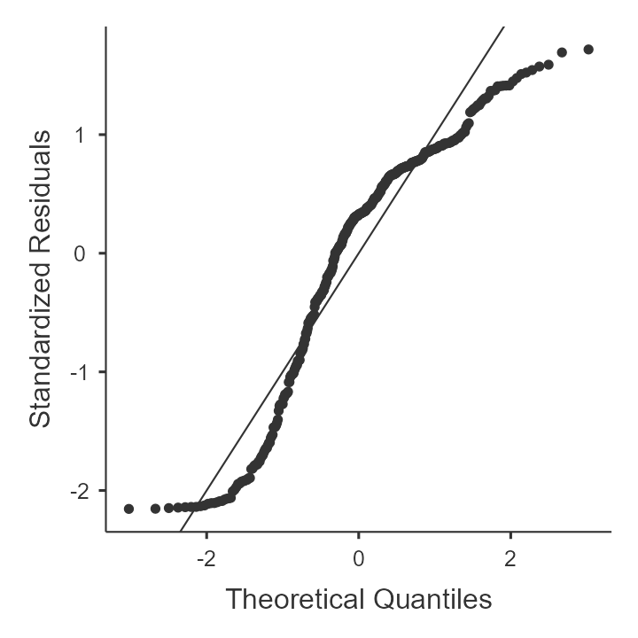
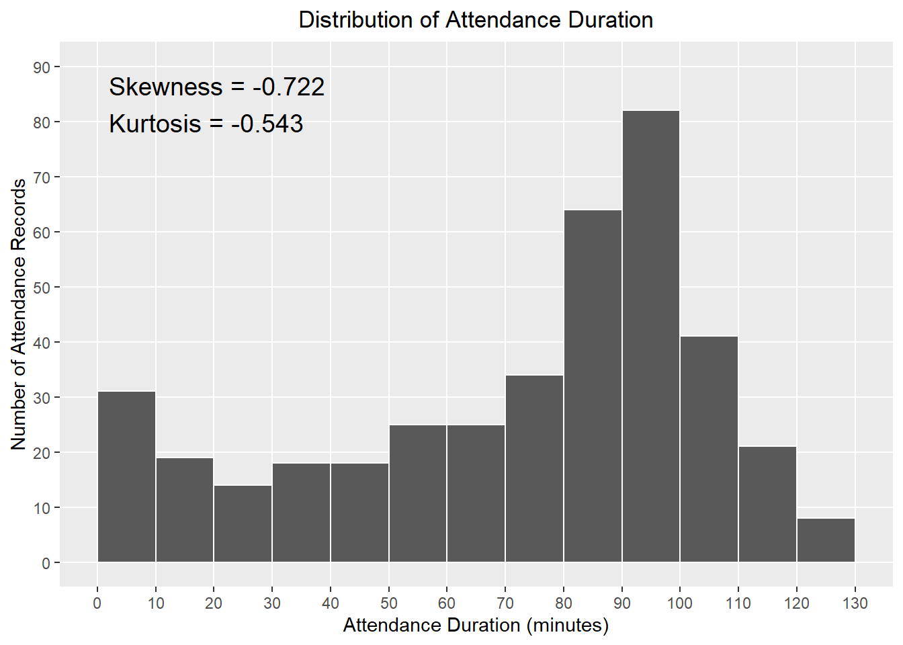
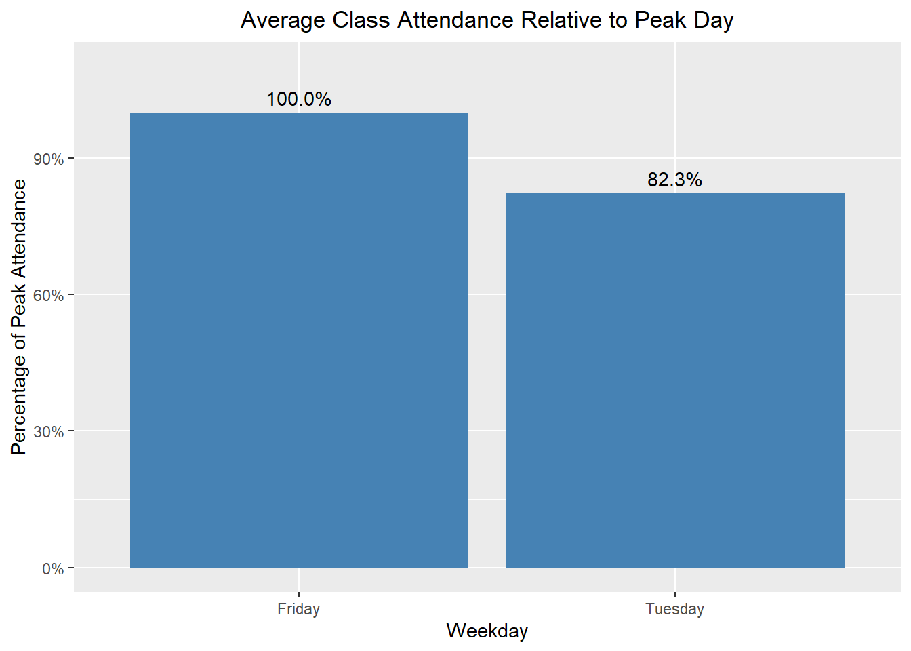
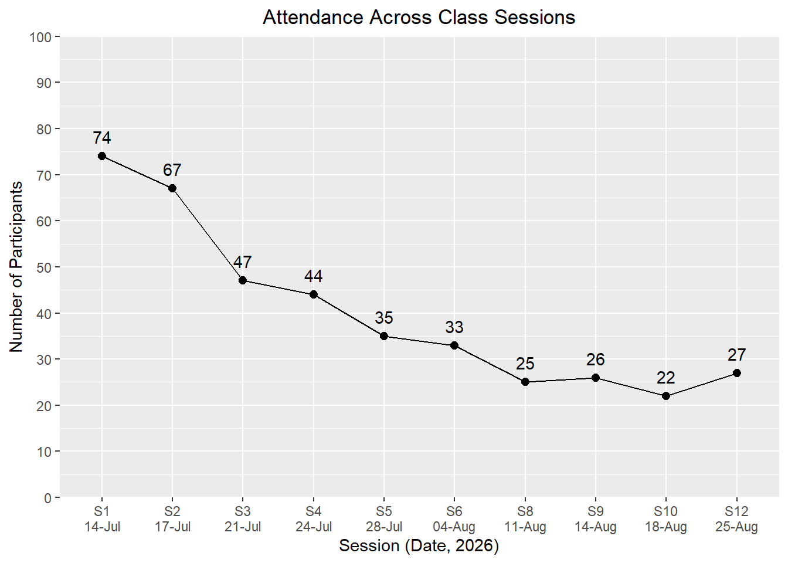
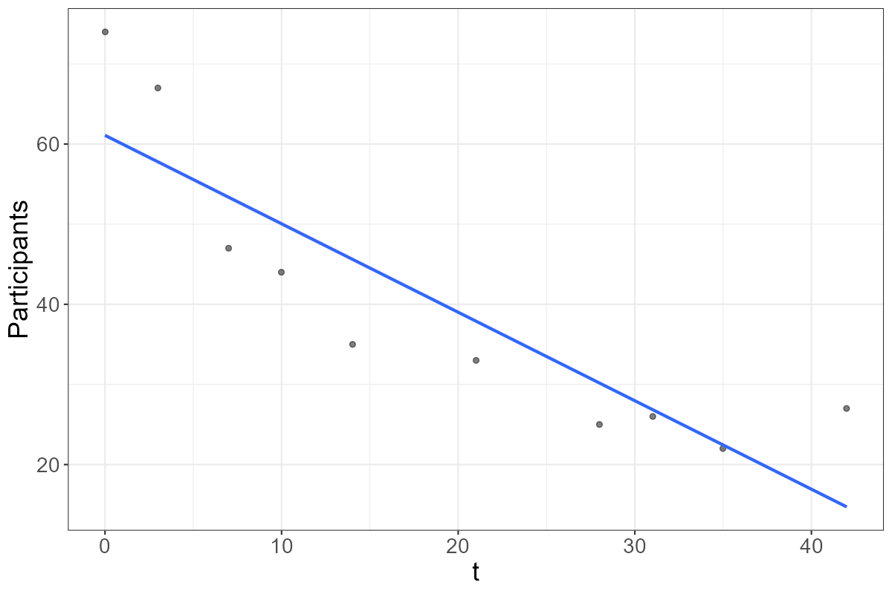
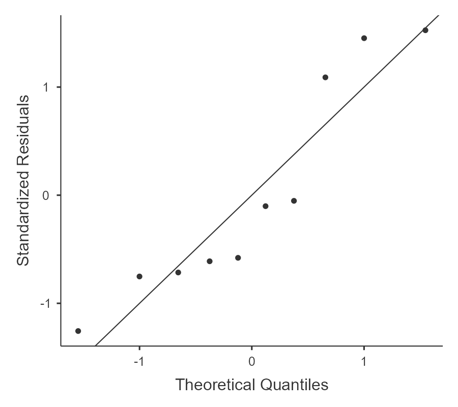
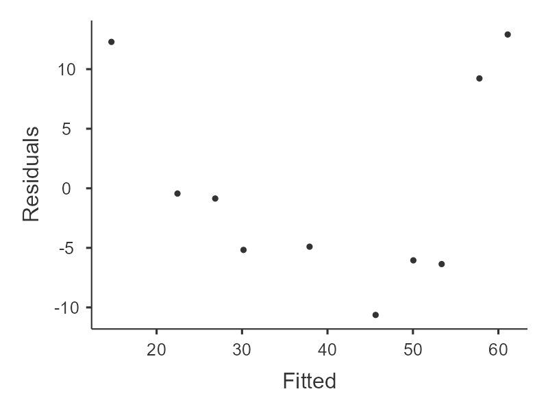
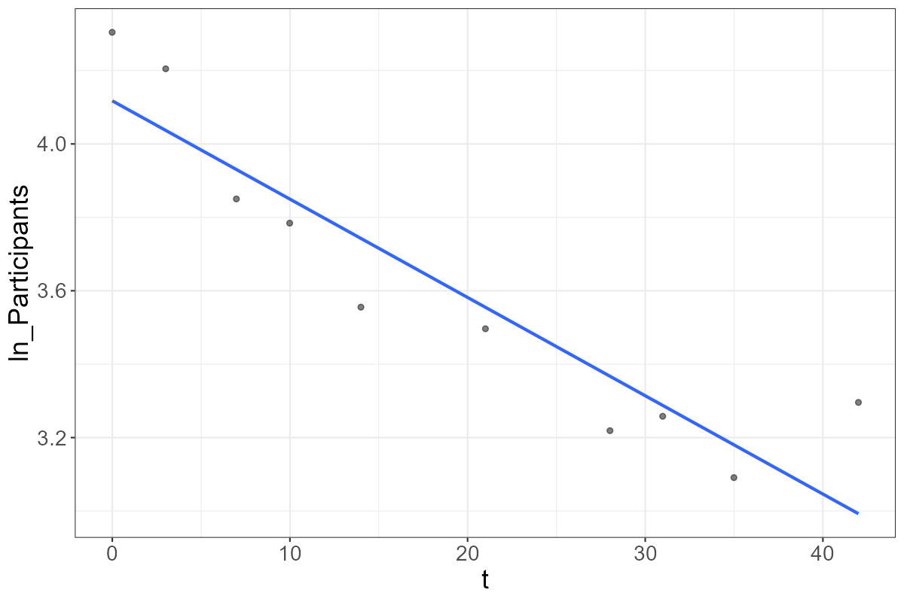
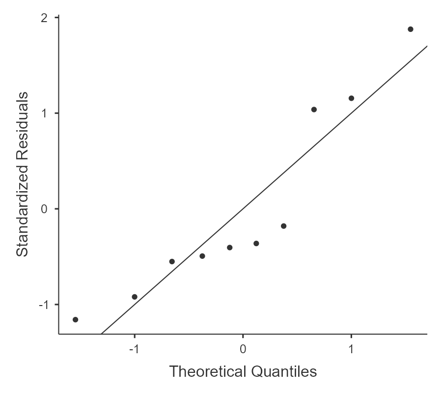
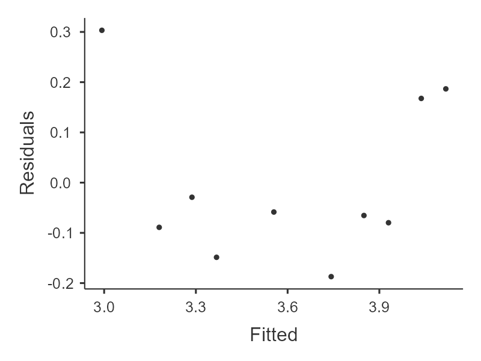

# Online Class Attendance Analyses (This isn't hitting the spot, need a new top header which is more relevant)

[](https://hits.sh/github.com/Shah-Md-Tasrif-Rahman/R_Attendance_CUSPC_SPSS_2026/)

## Overview

This repository contains statistical analyses of the attendance dataset of an SPSS course hosted by [Programming Club, Dept. of Statistics, CU](https://www.linkedin.com/company/programmingclub-stat-cu/), and conducted by [Md Ahsanul Islam (Himel)](https://www.linkedin.com/in/mdahsanulhimel/).

The main purpose of this project is to analyze participant behaviour in an online course over multiple sessions and to create regression models which can fit or explain such behaviour similarly for any other online courses of similar nature.

Main tools used for this project are: **R, renv, Jamovi, and Quarto.**

*This repository also contains a pseudonymized version of the original dataset for replication and future uses.*

## Dataset & Data Privacy

### Original Data

The original data for this project was collected using an extension in Google Meet to generate detailed meeting reports in CSV format. The course had a total of 12 sessions, which were held from 14/7/2026 to 25/8/2026. Due to technical errors, the data for session 7 and 11 were missing, which leaves us with data of only 10 sessions.

Key variables in the original dataset were:
- Participant Name
- Time when attendance started
- Joining time
- Time when attendance stopped
- Attendance duration

### Data Preparation

The CSV files for the 10 sessions were extracted and combined, and then attendance duration was calculated as new numeric variable. Variables concerned with the date was also included. This generated a Master_dataset, which was used for further processing. A leaderboard, daily attendance summary, weekday summary, and paired weekdays data was created.

### Privacy & Pseudonymization

The original dataset had the real names of participants, sharing them on the internet would be a privacy breach. To make the dataset publicly available, the names were pseudonymized, and new datasets were created using those pseudonyms. The pseudonymized datasets were then used for furthur statistical processing.

The repository is designed so the analytical/visualization portion doesn't require the original dataset with PII.

[Check out the pseudonymized master_dataset here](./Pseudonymization_process/Public_datasets/pseudonymized_master_dataset_full_context.xlsx)

## Research Questions

1. How is the attendance duration of participants distributed?

2. Is there a difference between the average attendance time at Fridays and Tuesdays?

3. Which regression model explains the participant attendance pattern best?

## Methods

#### Exploratory Data Analysis

- Descriptive statistics
- Distribution shape characteristics
- Visualization

#### Comparison Between Weekdays

- Normality tests
- Wilcoxon signed-rank test
- Visualization

#### Regression Models

- Linear model
- Exponential decay model
- Asymptotic exponential decay model

#### Model Diagnostics and Comparison

- ANOVA
- Heteroscedasticity Tests
- Durbin-Watson test
- Residual analysis
- AIC
- BIC
- RMSE
- Model visualization

## 1st Research Question

Let's see some descriptive statistics for the attendance duration of participants in this course.

#### Descriptive Statistics

| Statistic | Value |
|:----------|------:|
| *N* | 400 |
| Mean | 71.5 |
| SD | 33.1 |
| SE | 1.66 |
| Median | 82.3 |
| IQR | 45.6 |
| Minimum | 0.167 |
| Maximum | 128 |
| Skewness | -0.722 |
| SE of skewness | 0.122 |
| Kurtosis | -0.543 |
| SE of kurtosis | 0.243 |
| **Shapiro-Wilk *W*** | 0.916 |
| **Shapiro-Wilk *p*** | < .001 |

*Note*. SD = standard deviation, SE = standard error, IQR = interquartile range. All the values are as minutes of attendance.

From Shapiro-Wilk test, we have enough evidence to `reject normality for attendance duration distribution`. 

#### Q-Q plot


#### Attendance duration histogram


From these visualizations, we can see that the distribution of attendance duration of participants in this course is `negatively skewed and platykurtic`. This means that `most of the students who stay in the session stay for longer than average, and the peak attendance is flatter than if it was normally distributed`.

## 2nd Research Question

In this course, sessions were held at either Tuesday or Friday. Since this was an online course, participants were expected to stay longer in sessions at Friday (which counts as a weekend in this context). This course was mostly attended by university-level students. To test whether there's a difference between the average attendance duration of participants at Tuesday or Friday, a **paired-samples measure** was decided to be used.

Firstly, let's check the normality to decide what test we should use.

#### Normality Tests

| Test | Statistic | *p* |
|:------|:----------:|:--:|
| Shapiro-Wilk | 0.933 | .002 |
| Kolmogorov-Smirnov | 0.131 | .217 |
| Anderson-Darling | 1.29 | .002 |

Since we have enough evidence to reject normality for this dataset from Shapiro-Wilk and Anderson-Darling test, we'll use **Wilcoxon signed-rank test**.

#### Descriptives

| Group | *N* | Mean | Median | SD | SE |
|:------|--:|-----:|-------:|---:|---:|
| Tuesday_Mean_Minutes | 62 | 68.8 | 71.2 | 23.1 | 2.93 |
| Friday_Mean_Minutes | 62 | 72.7 | 78.8 | 27.2 | 3.45 |

*Note*. SD = standard deviation, SE = standard error.

For this dataset, Wilcoxon signed-rank test showed a `non-significant difference between the median attendance duration of participants at Tuesday or Friday`, *W* = 747, *p* = .108.



So there's some difference between the attendance duration, but it's not statistically significant.

## 3rd Research Question

Let's look at how the participant attendance number is distributed first.



This visualization looks closer to a linear regression model or exponential decay regression model. Let's fit a linear regression model first.

#### Normality Tests

| Test | Statistic | *p* |
|:------|:--:|:--:|
| Shapiro-Wilk | 0.868 | .096 |
| Kolmogorov-Smirnov | 0.221 | .638 |
| Anderson-Darling | 0.622 | .075 |

*Note*. Not enough evidence to reject normality was found here.

#### Heteroscedasticity Tests

| Test | Statistic | *p* |
|:------|:--:|:--:|
| Breusch-Pagan | 0.771 | .380 |
| Goldfeld-Quandt | 0.913 | .529 |
| Harrison-McCabe | 0.685 | .809 |

*Note*. Not enough evidence to reject homoscedasticity was found here.

#### Model Fit Measures

| *R* | *R²* | Adjusted *R²* | AIC | BIC | RMSE | *F* | df1 | df2 | *p* |
|:--:|:--:|:--:|:--:|:--:|:--:|:--:|:--:|:--:|:--:|
| 0.884 | 0.781 | 0.753 | 76.0 | 76.9 | 8.03 | 28.5 | 1 | 8 | < .001 |

*Note*. Model estimated using sample size of n = 10.

#### Model Coefficients

| Predictor | Estimate | SE | *t* | *p* |
|:--:|:--:|:--:|:--:|:--:|
| Intercept | 61.09 | 4.866 | 12.55 | < .001 |
| t | -1.10 | 0.207 | -5.34 | < .001 |

*Note*. Model predicts participants over time (t). SE = standard error.

#### Durbin-Watson Test

| Autocorrelation | DW Statistic | *p* |
|:--:|:--:|:--:|
| 0.372 | 0.762 | .002 |

*Note*. There's statistically significant evidence of positive autocorrelation in the model residuals.

#### Regression Plot



#### Q-Q Plot


#### Residual vs. Fitted Plot


As we can see, the fitted linear regression model has a few issues. Mainly, it suffers from autocorrelation, and the Q-Q plot and Residual vs. Fitted plot shows poor fitting issues. To alleviate these, we'll log-transform this model for a better overall fit.

#### Normality Tests

| Test | Statistic | *p* |
|:------|:--:|:--:|
| Shapiro-Wilk | 0.874 | .112 |
| Kolmogorov-Smirnov | 0.271 | .383 |
| Anderson-Darling | 0.644 | .065 |

*Note*. Not enough evidence to reject normality was found here.

#### Heteroscedasticity Tests

| Test | Statistic | *p* |
|:------|:--:|:--:|
| Breusch-Pagan | 0.835 | .361 |
| Goldfeld-Quandt | 6.06 | .087 |
| Harrison-McCabe | 0.462 | .419 |

*Note*. Not enough evidence to reject homoscedasticity was found here.

#### Model Fit Measures

| *R* | *R²* | Adjusted *R²* | AIC | BIC | RMSE | *F* | df1 | df2 | *p* |
|:--:|:--:|:--:|:--:|:--:|:--:|:--:|:--:|:--:|:--:|
| 0.923 | 0.852 | 0.833 | -3.14 | -2.23 | 0.153 | 46.0 | 1 | 8 | < .001 |

*Note*. Model estimated using sample size of n = 10.

#### Model Coefficients

| Predictor | Estimate | SE | *t* | *p* |
|:--:|:--:|:--:|:--:|:--:|
| Intercept | 4.1174 | 0.09289 | 44.32 | < .001 |
| *t* | -0.0268 | 0.00395 | -6.78 | < .001 |

*Note*. Model predicts participants over time (t). The variable "Participants" was transformed into ln_Participants for this model. SE = standard error.

#### Durbin-Watson Test

| Autocorrelation | DW Statistic | *p* |
|:--:|:--:|:--:|
| 0.149 | 1.16 | .070 |

*Note*. There's not enough evidence of autocorrelation in the model residuals.

#### Regression Plot



#### Q-Q Plot


#### Residual vs. Fitted Plot


Here we can see that, the log-transformed model doesn't suffer from the autocorrelation issue, but the Q-Q plot and Residual vs. Fitted plot still shows poor fitting issues.

This means it's better that we use an **exponential decay regression model** and an **asymptotic exponential decay regression model** to furthur fit this dataset.

Up until now, Jamovi was used in the analysis. Now we'll use R to fit these new models using **Nonlinear Least Squares** method or `nls()`.

Let's consider the following regression models:

```math
\begin{aligned}
\text{Linear model (Baseline model):}\quad
& y_i = z + tx_i + \varepsilon_i \\

\text{Exponential decay model:} \quad
& y_i = ae^{bx_i} + \varepsilon_i,\; b<0 \\

\text{Asymptotic exponential model:} \quad
& y_i = c + ae^{bx_i} + \varepsilon_i,\; b<0
\end{aligned}
```
Where,
```math
\begin{aligned}
y_i &= \text{Number of participants (Target variable)} \\
x_i &= \text{Days since first session (Explanatory variable)} \\
z &= \text{Intercept of the linear model} \\
t &= \text{Linear rate of change} \\
a &= \text{Initial amplitude} \\
b &= \text{Exponential decay rate} \\
c &= \text{Asymptotic participant count} \\
\varepsilon_i &= \text{Residual error}
\end{aligned}
```
